# Pertemuan 07 — Komposisi dan Agregasi

| | |
|---|---|
| **Nama** | Karel Abimanyu Ahpandi |
| **NIM** | 4525210031 |
| **Kelas** | A |
| **Mata kuliah** | Praktikum Pemrograman Berorientasi Objek (PBO) |
| **Bahasa** | Java dan PHP |

Pertemuan ini membedakan dua jenis relasi "memiliki":

- **Komposisi**: `Buku` memiliki `Bab`. Bab dibuat di dalam `Buku`, tidak bisa berpindah ke buku lain, dan tidak berarti apa pun di luar bukunya.
- **Agregasi**: `Jurusan` menaungi `Mahasiswa`. Objek `Mahasiswa` dibuat di luar, diterima oleh `Jurusan`, dan tetap hidup walaupun dikeluarkan dari jurusan.

Konteks sistemnya ada di [`deskripsi-kebutuhan.md`](deskripsi-kebutuhan.md), yaitu Sistem Perpustakaan Universitas Pancasila yang menjadi dasar pekerjaan sesi 7 sampai 14.

## Struktur folder

```
Pert07/
├── deskripsi-kebutuhan.md   # deskripsi Sistem Perpustakaan dari dosen
├── uml/                     # perpustakaan-kerangka.puml (class diagram kerangka)
├── before/                  # kode awal dari dosen (masih ada TODO)
│   ├── java/                # Main, model/Buku, model/Jurusan, service/PerpustakaanService
│   ├── php/                 # relasi.php (semua kelas), main.php
│   └── uml/                 # perpustakaan-kerangka.puml
├── after/
│   └── starter/             # kode setelah TODO dikerjakan
│       ├── java/            # struktur sama dengan before/java
│       └── php/             # relasi.php, main.php
├── img/
│   ├── before/              # screenshot kode dan output sebelum
│   └── after/               # screenshot kode dan output sesudah
└── README.md
```

## Yang dikerjakan (before → after)

### Java

Cara kompilasi dan menjalankan (dari folder `after/starter/java`):

```bash
javac -d out $(find . -name "*.java")
java -cp out Main
```

Di PowerShell, `$(find ...)` tidak tersedia. Gunakan `javac -d out Main.java model\Buku.java model\Jurusan.java service\PerpustakaanService.java`.

| Berkas | Before | After |
|---|---|---|
| `Buku.java` — constructor | TODO 1: jumlah eksemplar negatif belum ditolak | Melempar `IllegalArgumentException` bila `jumlahEksemplar < 0` |
| `Buku.java` — `tambahBab()` | Badan method kosong, sehingga buku selalu 0 bab | `bab.add(new Bab(nomor, judulBab))`. Parameternya nomor dan judul, bukan objek `Bab`, sehingga `Bab` hanya lahir dari dalam `Buku` (komposisi) |
| `Buku.java` — `getBab()` | `return bab;` mengembalikan list internal, sehingga bisa dikosongkan dari luar lewat `clear()` | `return List.copyOf(bab);` mengembalikan salinan tak-berubah, `clear()` dari luar melempar `UnsupportedOperationException` |
| `Buku.java` — `kurangiStok()` | Badan method kosong | Melempar `IllegalStateException` bila stok sudah 0, selain itu stok dikurangi satu |
| `Buku.java` — `Bab` | Kelas bersarang `static final` dengan constructor `private` | Tidak diubah. Hanya `Buku` yang boleh membuat `Bab` |
| `Jurusan.java` — `daftarkan()` | TODO 1: badan method kosong | Menolak `null` dengan `Objects.requireNonNull` dan melewati NIM yang sudah terdaftar. Belum ada baris yang menambahkan mahasiswa ke list (lihat Catatan) |
| `Jurusan.java` — `keluarkan()` | Badan method kosong | `removeIf` berdasarkan NIM. Objek `Mahasiswa` tetap hidup di luar |
| `Jurusan.java` — `getMahasiswa()` | `return mahasiswa;` | `return List.copyOf(mahasiswa);` |
| `PerpustakaanService.java` | Hanya kerangka, semua method kosong | Menyimpan koleksi di `List<Buku>`. `tambahKoleksi()` mengabaikan `null` dan nomor induk ganda, `cariKoleksi()` mencari tanpa membedakan huruf besar kecil, `pinjam()` mengurangi stok bila buku tersedia, `kembalikan()` menambah stok |
| `Main.java` | Tidak ada perubahan isi | Hanya spasi di depan baris `import model.Buku;` |

### PHP

Seluruh kelas ada di `relasi.php`. Cara menjalankan (dari folder `after/starter/php`):

```bash
php main.php
```

| Bagian | Before | After |
|---|---|---|
| `enum JenisKeanggotaan` | Belum ada | Baru: `MAHASISWA`, `DOSEN`, `UMUM` |
| `enum StatusKoleksi` | Belum ada | Baru: `TERSEDIA`, `DIPINJAM`, `HILANG` |
| `Bab` | Tanpa constructor, `__toString()` hanya mengembalikan teks "TODO 1 belum dikerjakan" | Menyimpan `nomor` dan `judul` lewat constructor, ada getter, `__toString()` menghasilkan `Bab 1: Paradigma Objek`. Constructor-nya publik, jadi aturan "hanya `Buku` yang membuat `Bab`" dijaga lewat konvensi karena PHP tidak punya kelas bersarang |
| `Buku` — constructor | Properti lewat constructor promotion `readonly`, validasi belum ada | Properti ditulis biasa, ada parameter `StatusKoleksi $status` (default `TERSEDIA`), jumlah eksemplar negatif melempar `InvalidArgumentException` |
| `Buku::tambahBab()` | Badan method kosong | `$this->bab[] = new Bab($nomor, $judulBab)` |
| `Buku::kurangiStok()` | Badan method kosong | Melempar `UnderflowException` bila stok 0. Setelah dikurangi, bila stok menjadi 0 maka status berubah menjadi `DIPINJAM` |
| `Buku::tambahStok()` | Hanya `jumlahEksemplar++` | Menambah stok dan mengembalikan status ke `TERSEDIA` |
| `Buku::__toString()` | `[3 eks, 3 bab]` | Ditambah status: `[3 eks, 3 bab, status: TERSEDIA]` |
| `Mahasiswa` | Hanya `nim` dan `nama` | Ditambah `JenisKeanggotaan $jenis` (default `MAHASISWA`), `getNama()`, `getJenis()`, dan `__toString()` menampilkan jenisnya |
| `Jurusan::daftarkan()` | Badan method kosong | Melewati NIM yang sudah terdaftar, selain itu mahasiswa ditambahkan |
| `Jurusan::keluarkan()` | Badan method kosong | Menghapus berdasarkan NIM lalu merapikan indeks dengan `array_values()` |
| `main.php` | Tidak ada perubahan | Tidak diubah |

## Screenshot

### Before

**`Buku.java`**

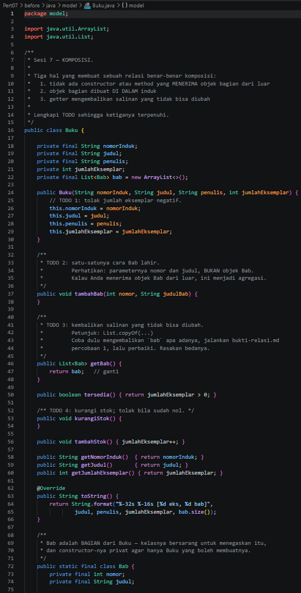

**`Jurusan.java`**

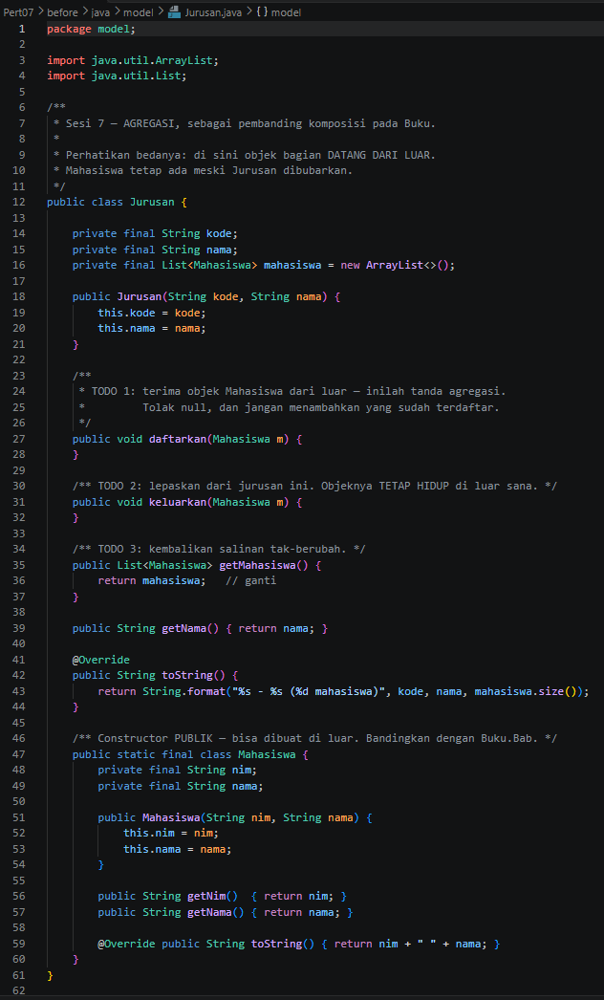

**`PerpustakaanService.java`**

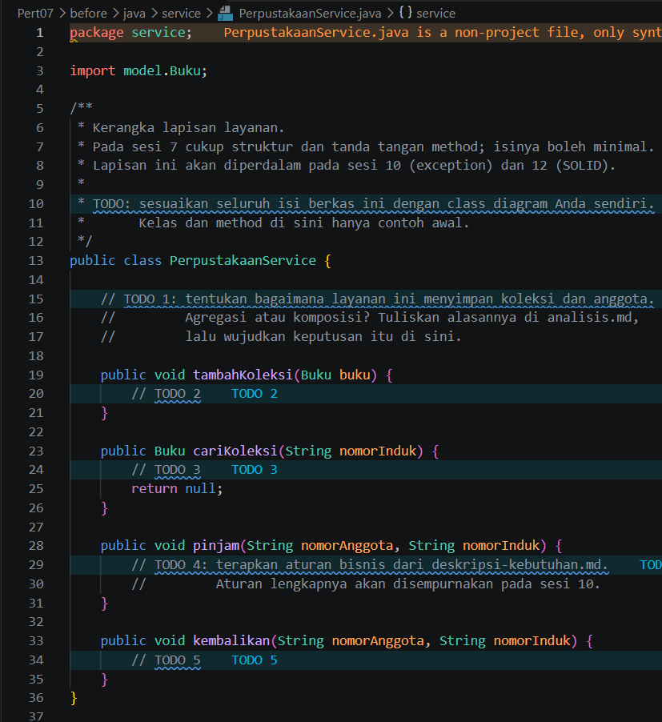

**`Main.java`**

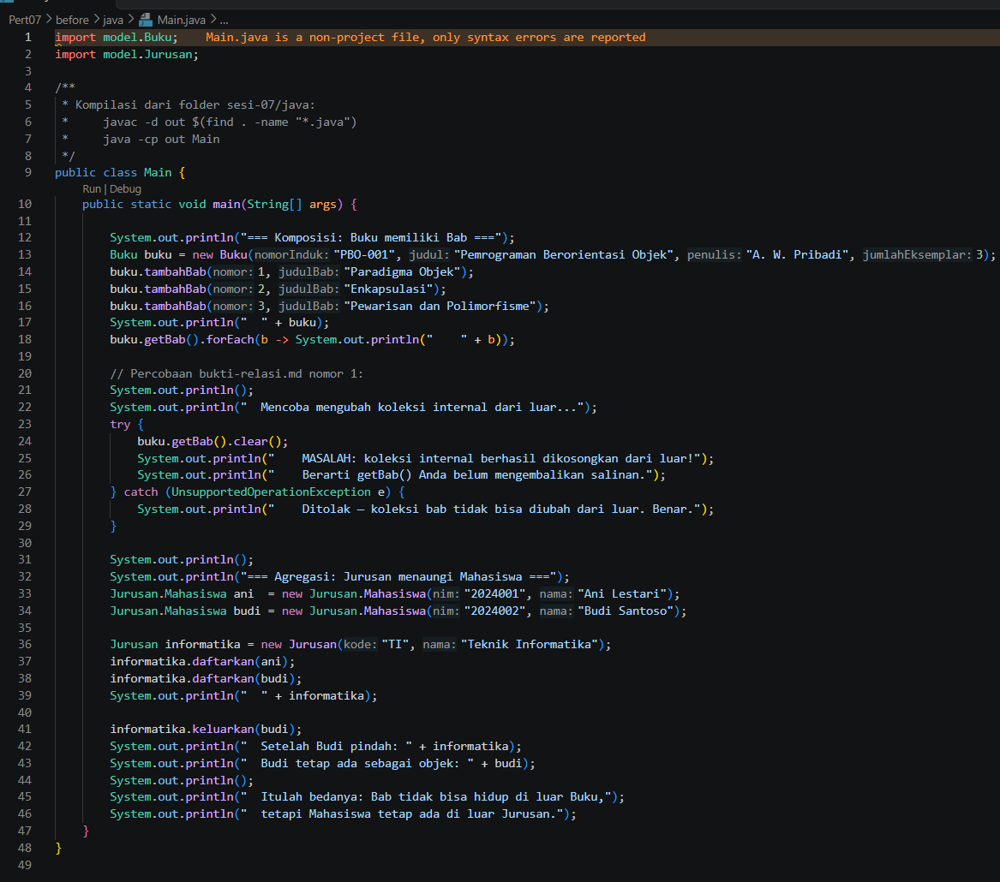

**`relasi.php`**

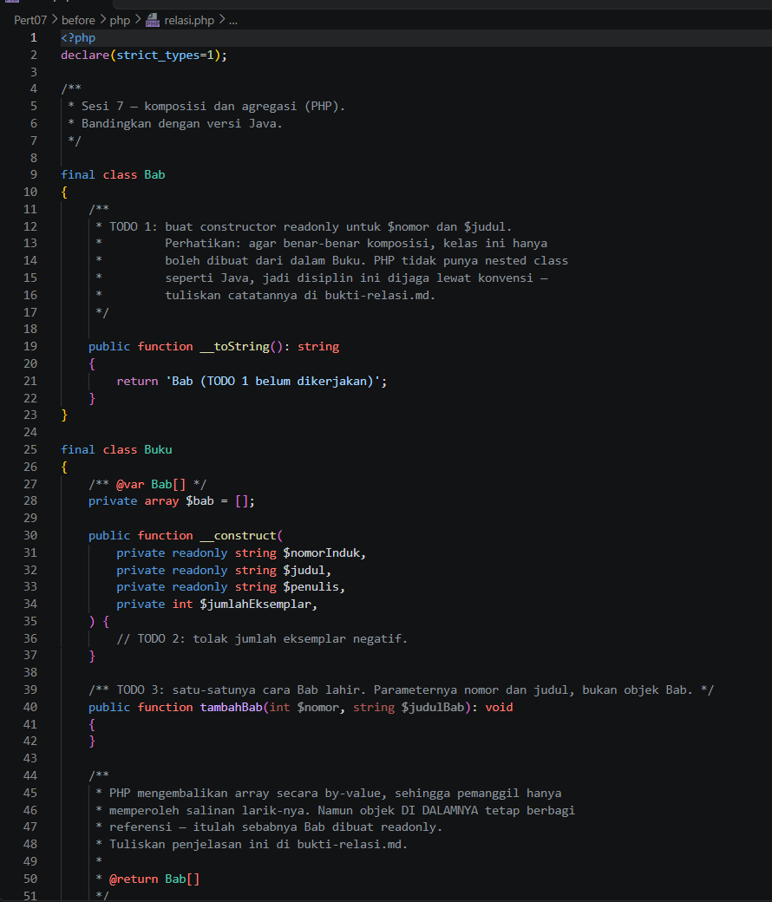

**`main.php`**

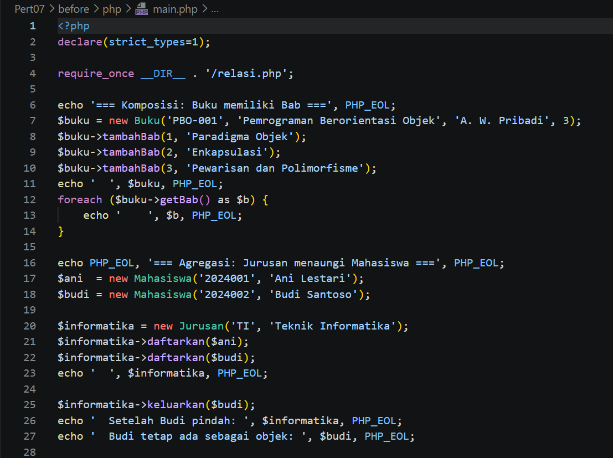

### After

**`Buku.java`**

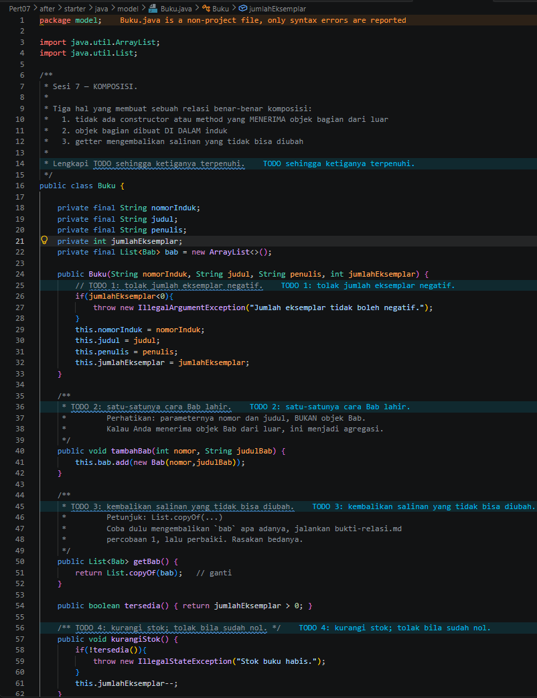

**`Jurusan.java`**

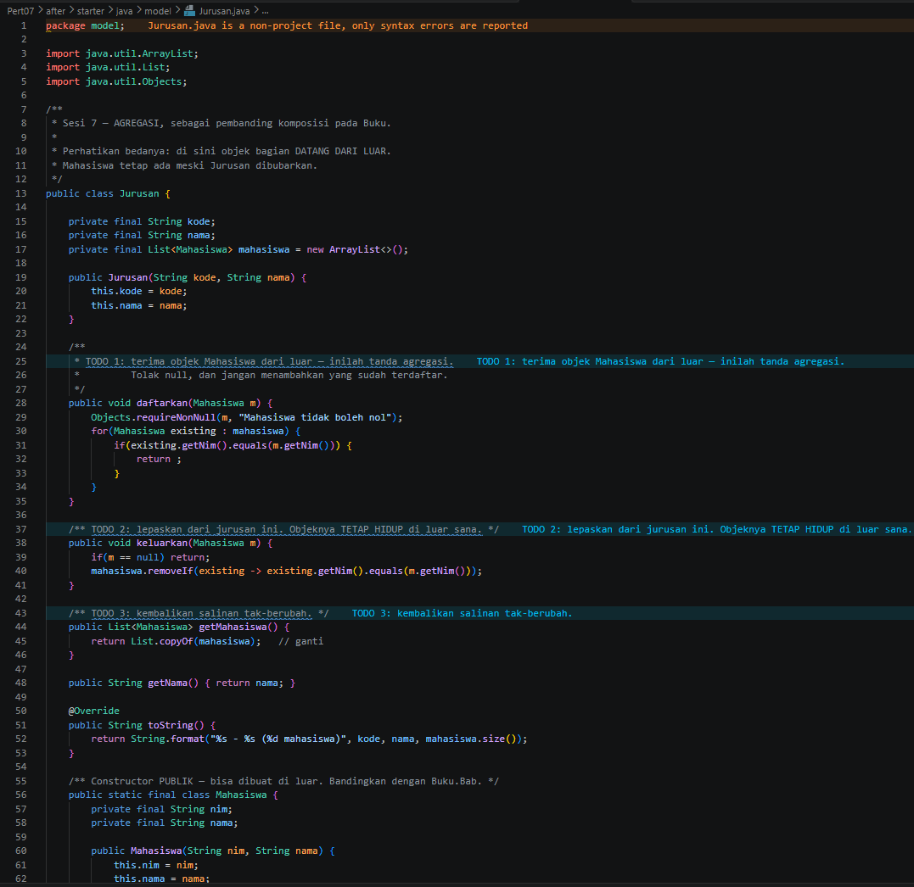

**`PerpustakaanService.java`**

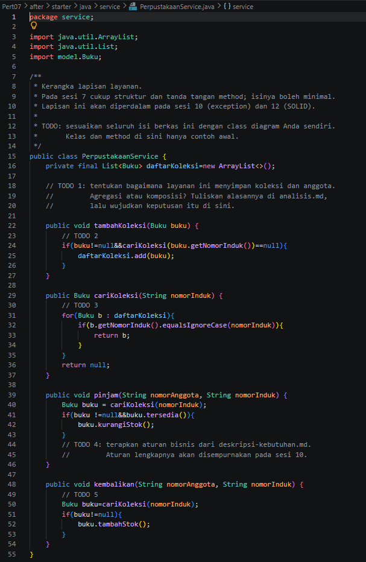

**`Main.java`**

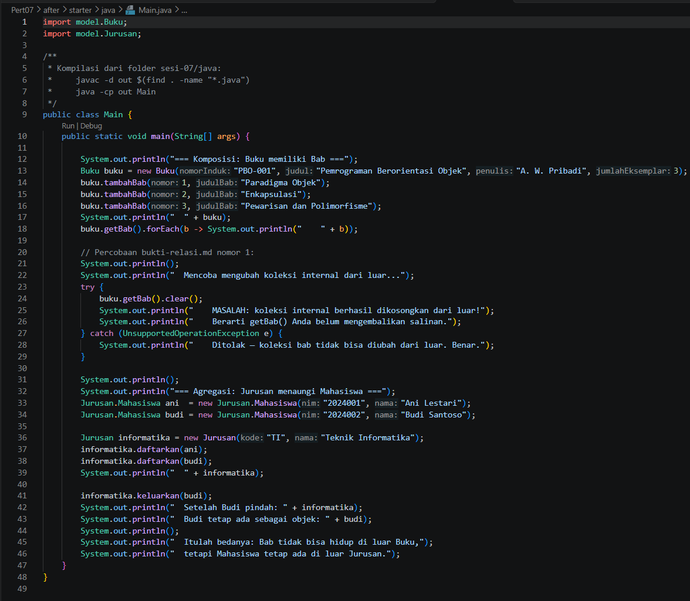

**`relasi.php`**

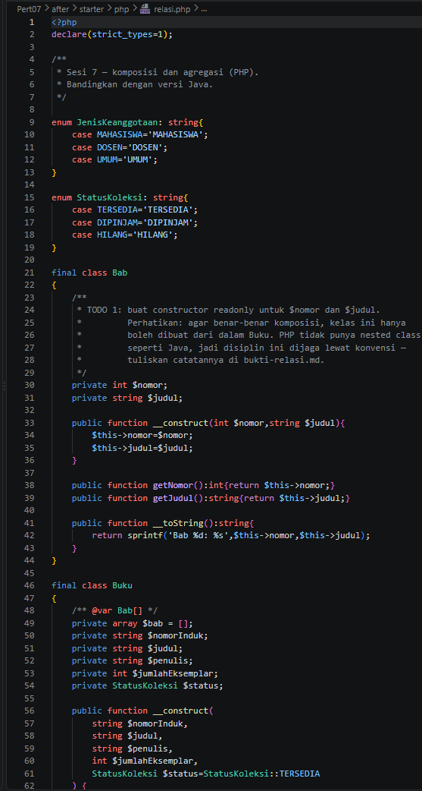

**`main.php`**

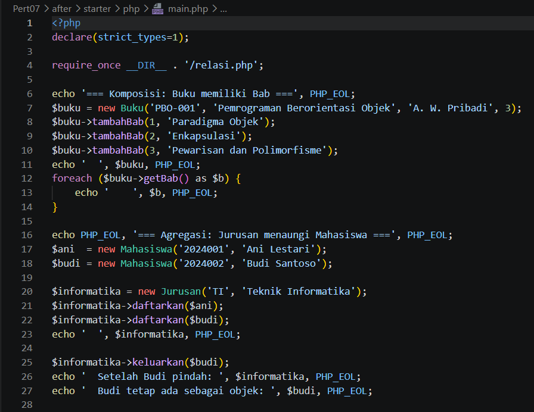

## Output

### Before

**Java**

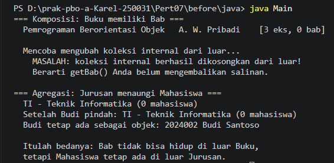

**PHP**

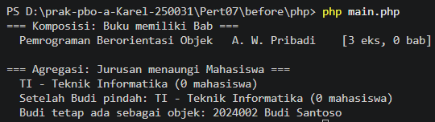

### After

**Java**

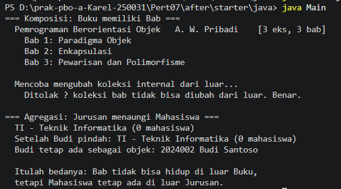

**PHP**

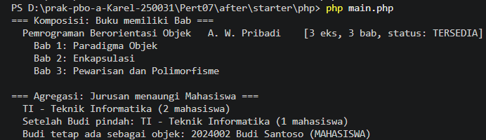

## Catatan

| Hal | Keterangan |
|---|---|
| Java: `Jurusan.daftarkan()` | Loop pengecekan duplikat sudah ada, tetapi tidak ada `mahasiswa.add(m)` setelahnya. Akibatnya output Java menampilkan `(0 mahasiswa)` di tiga baris agregasi, sedangkan versi PHP menampilkan `2 mahasiswa` lalu `1 mahasiswa`. Perbaikannya satu baris, `mahasiswa.add(m);`, tepat setelah loop |
| Java: `PerpustakaanService.pinjam()` | Parameter `nomorAnggota` belum dipakai. Aturan batas 3 peminjaman dan denda baru disempurnakan pada sesi 10 sesuai komentar TODO |
| PHP: `Bab` | Properti `nomor` dan `judul` ditulis biasa, bukan `readonly` seperti petunjuk TODO 1 |
| `uml/perpustakaan-kerangka.puml` | Masih berupa kerangka dari dosen (7 komentar TODO, relasi `Koleksi <|-- Bab` yang memang sengaja dibuat salah). Tidak ada versi `after` untuk diagram ini |
| Komentar TODO | Masih ada di kode `after` (Java dan PHP). Komentar juga menyebut `analisis.md` dan `bukti-relasi.md`, yang tidak ada di folder ini |
| Tampilan `?` pada output Java | Pada terminal Windows, tanda pisah `—` di teks "Ditolak — koleksi bab..." tampil sebagai `?`. Ini masalah encoding terminal, bukan kesalahan program |

## Kesimpulan

Komposisi dan agregasi dibedakan oleh siapa yang membuat objek bagian dan siapa yang mengendalikan umurnya. `Buku` membuat `Bab` sendiri lewat `tambahBab(nomor, judul)` dan hanya membagikan salinan tak-berubah lewat `getBab()`, sehingga bab tidak bisa dikosongkan atau dipindahkan dari luar. `Jurusan` sebaliknya menerima objek `Mahasiswa` dari luar, sehingga setelah dikeluarkan, mahasiswanya tetap ada sebagai objek. Java menegakkan perbedaan ini lewat kelas bersarang dengan constructor `private`, sedangkan PHP hanya bisa menjaganya lewat konvensi. Dari uji jalan, versi PHP sudah benar mengikuti perilaku agregasi, sementara versi Java masih perlu satu baris tambahan di `Jurusan.daftarkan()` agar mahasiswa benar-benar tercatat.
